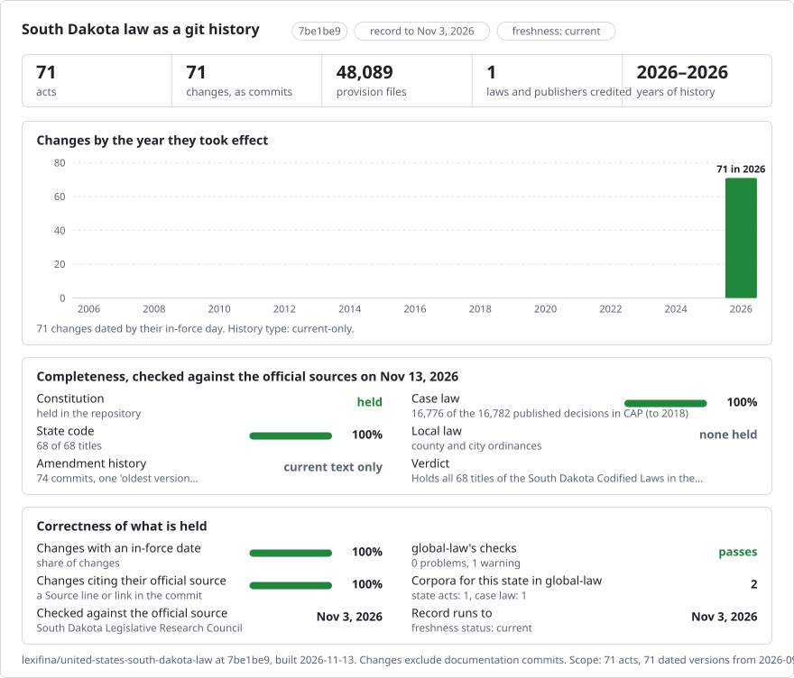

# South Dakota: law history in git

<picture>
<source media="(prefers-color-scheme: dark)" srcset="data/effort-dark.svg">

</picture>

Part of [lexifina/global-law](https://github.com/lexifina/global-law), one git history for every country's law: this is the law of South Dakota, United States, which global-law reads at `united-states/south-dakota/acts/`.

The statute law of South Dakota as a git repository: one file per section, committed with the official publisher named as author. It follows the shared design of [lexifina/global-law](https://github.com/lexifina/global-law).

**What is in it now (a first build, not complete)**

| Folder | Act | Versions | History |
| --- | --- | ---: | --- |
| `constitution/` | Constitution of the State of South Dakota | 1 | Current text (oldest version available) |
| `title-22-crimes/` | SDCL Title 22: Crimes | 1 | Current text (oldest version available) |
| `chapter-47-1a-business-corporations/` | SDCL chapter 47-1A: South Dakota Business Corporation Act | 1 | Current text (oldest version available) |
| `chapter-43-32-residential-landlord-tenant/` | SDCL chapter 43-32: Landlord and Tenant | 1 | Current text (oldest version available) |

Nothing else of South Dakota's law is in it yet.

## Where the text comes from

[South Dakota Legislature: Constitution and Codified Laws](https://sdlegislature.gov/Statutes), South Dakota Legislative Research Council, read through the site's public JSON API. Only the section heading and text are taken; the Source and History lines are left out.

## Dates

Each act has one version, dated 3 September 2026: the last statute effective date the Legislative Research Council's API reports.

## What it does not show

- The Legislative Research Council publishes only the current text, so there is no history yet.
- Only the Constitution, Title 22, chapter 47-1A and chapter 43-32 are included.
- Source lines (session law citations) are not kept.

## How it is checked

- Every unit is read back from git on its day and compared with the corpus (`tools/check_repo.py`; results in `REPRODUCE.md`).
- Each source file is identified by its sha256, in `data/versions.json`.

## What "author" means

Each commit is authored by the publisher (South Dakota Legislative Research Council) because this first build holds one version of each act, the oldest version available. The committer is always Lexifina.
